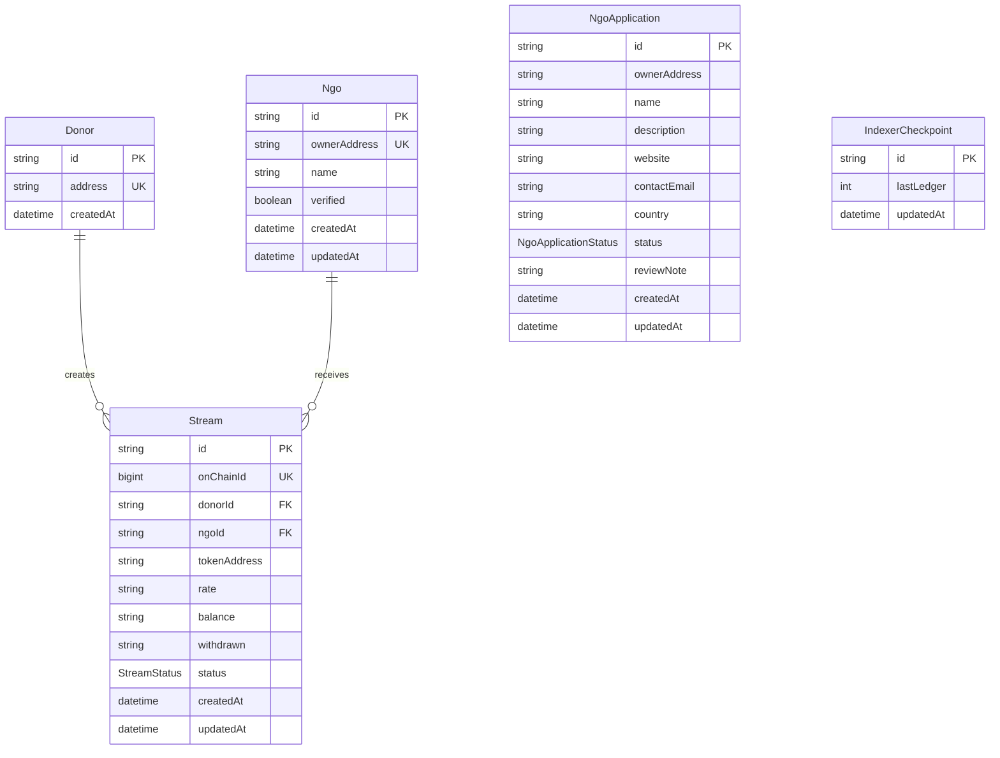

# Data model and API statistics

## Entity relationship diagram

`NgoApplication` is an off-chain review record and currently has no Prisma
relation to `Ngo`; applications are associated by `ownerAddress` in the API.
`IndexerCheckpoint` is a standalone, single-row-per-id table used to resume
event indexing.

## Derived statistics

Amounts are returned as decimal strings in the token's base units. The API does
not convert or combine values across different `tokenAddress` values.

For a stream, define its committed amount as:

- **Active:** `balance + withdrawn`
- **Cancelled:** `withdrawn`

Cancellation refunds the remaining `balance` to the donor, so that amount was
not committed to or delivered to the NGO. The already-withdrawn amount remains
part of the NGO's committed and withdrawn totals.

### `GET /ngos/:id`

The same detail response is also available from `GET /ngos/lookup?address=...`.
Its `stats` fields are computed from every stream belonging to the NGO:

- `totalCommitted`: sum of each stream's committed amount using the active and
  cancelled rules above.
- `totalWithdrawn`: sum of `withdrawn` across all streams, including cancelled
  streams.
- `activeStreamCount`: number of streams whose status is `ACTIVE`. Cancelled
  streams are excluded.
- `donorCount`: number of distinct donors represented by the NGO's streams;
  cancelled streams are included.

### `GET /impact/:ngoId`

The endpoint computes the same NGO totals from its streams and adds:

- `activeStreams`: count of `ACTIVE` streams.
- `cancelledStreams`: count of `CANCELLED` streams.
- `uniqueDonors`: distinct donor count, including donors whose streams were
  cancelled.
- `platformSharePercent`: `ngoCommitted / platformCommitted * 100`, where both
  values use the committed-amount rules above and `platformCommitted` includes
  every stream in the database. The result is truncated to two decimal places;
  it is `0` when the platform total is zero.

The platform-wide denominator includes cancelled streams only through their
withdrawn amounts, just like the NGO numerator.
